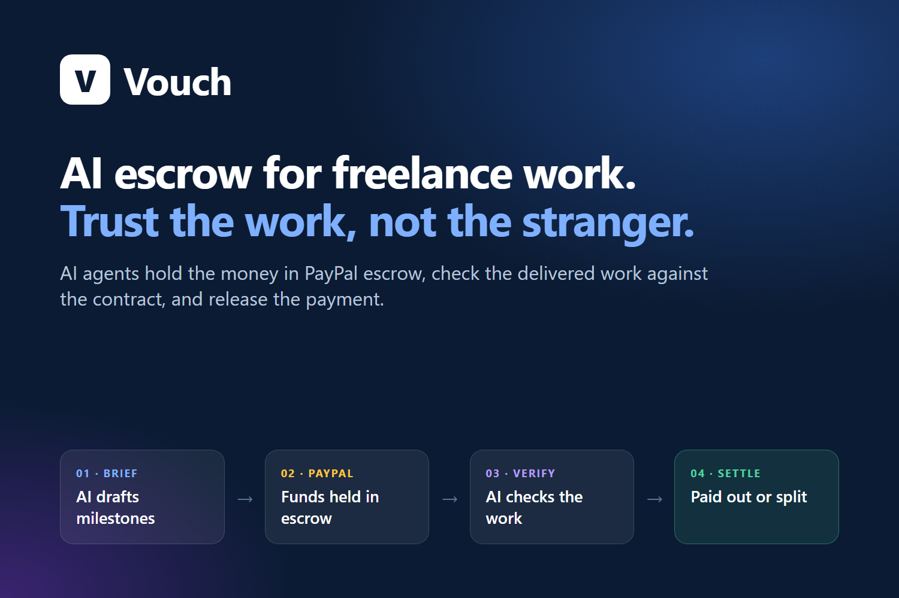
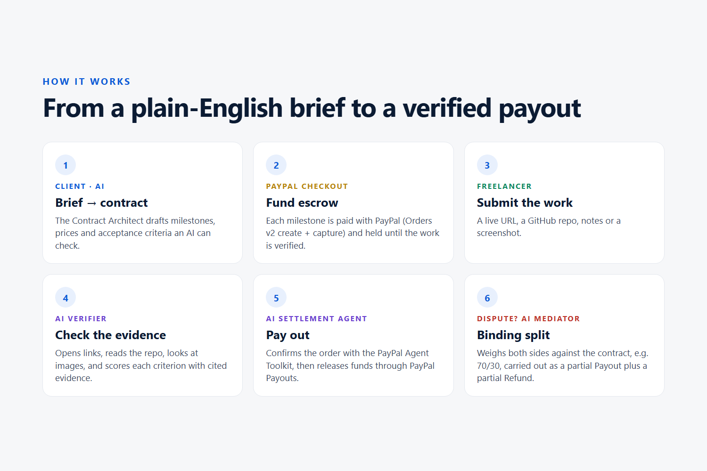
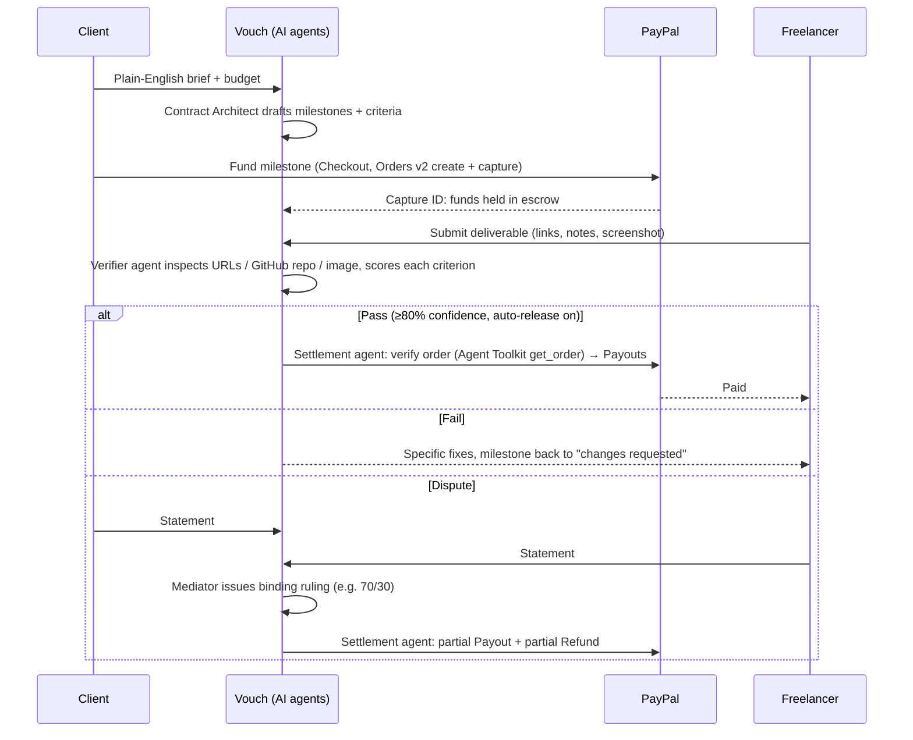
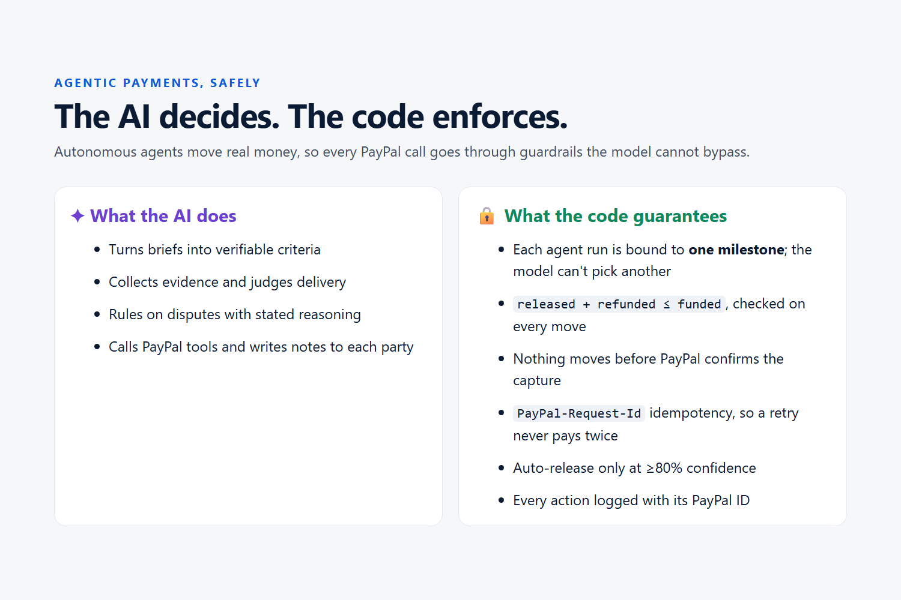
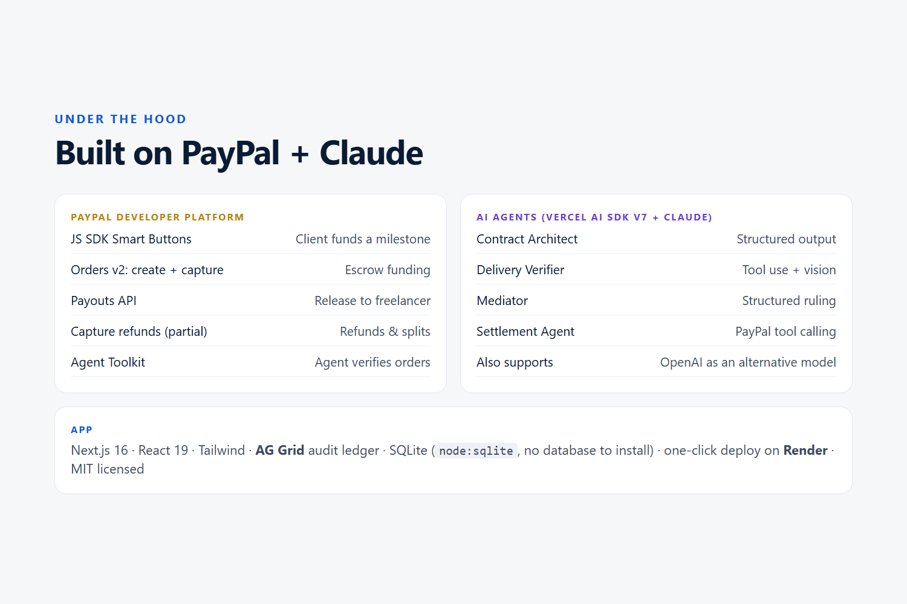

# Vouch: AI escrow for freelance work, built on PayPal



> Get paid for freelance work, without needing to trust a stranger.

Built for the [PayPal AI Hackathon](https://paypalaihackathon.devpost.com/) ("Build what's next with PayPal and AI") by Abdelrahman Farag and Alaa Kotb. All payments run in the PayPal sandbox.

**Live demo:** https://vouch-crnw.onrender.com. It's hosted on Render's free plan: if it has been idle, the first load can take up to a minute, and demo data resets when the server restarts. **Sandbox buyer login** for PayPal checkout: `sb-qcxbo35513902@personal.example.com` / `U)39&Tpb`. See the [3-minute walkthrough](#3-minute-walkthrough).

**Vouch** is milestone escrow run by AI agents on top of PayPal. A client describes a job in plain English. An AI **Contract Architect** turns the brief into milestones with objective acceptance criteria. The client funds each milestone with **PayPal Checkout**, and the money is held in escrow. When the freelancer delivers, an AI **Verifier** inspects the live site, GitHub repo or screenshots against each criterion. An AI **Settlement Agent** then pays the freelancer through **PayPal Payouts**. If the parties disagree, an AI **Mediator** issues a binding ruling, and the agent splits the escrow with a partial payout plus a partial **refund**.

## The problem

- Freelancers regularly go unpaid by clients who disappear after delivery. Clients pay up-front and receive late, partial or no work.
- Buyer protection on consumer payment platforms generally doesn't cover services, so there is no neutral party.
- Marketplaces solve trust by taking **10–20%** of every job and locking both sides into their platform.
- Their dispute processes are slow and manual. A human reviewer reads a long thread and has to guess.

Vouch lets any two people anywhere do a deal with the trust layer of a marketplace and none of the lock-in. A neutral AI reads the contract, looks at the actual work, and moves the money.

## How it works





### The AI agents

| Agent | What it does | Tools |
|---|---|---|
| **Contract Architect** | Turns a brief into 1–5 milestones with amounts that sum to the budget, *verifiable* acceptance criteria, and a list of ambiguities to clarify | Structured output (zod schema) |
| **Delivery Verifier** | Checks each criterion against real evidence it collects itself, and cites what it found | `inspect_url` (reads live pages, GitHub README and file tree), image input for screenshots |
| **Mediator** | Weighs both parties' statements and the verifier's evidence against the contract, then issues a percentage ruling | Structured output |
| **Settlement Agent** | Executes a decision: cross-checks Vouch's records against PayPal, then moves money and writes the notes each party sees | PayPal Agent Toolkit (`get_order`, `get_refund`), `release_to_freelancer`, `refund_to_client` |

### Safety: AI decides, code enforces



Agents never get unrestricted access to money:

- Each agent run is **bound to one milestone** by a closure. The model never picks which escrow to touch.
- `src/lib/escrow.ts` enforces `released + refunded ≤ funded` and refuses to move funds before PayPal confirms the capture. These checks apply whether a human or the agent triggered the move.
- Every Payout and Refund carries a deterministic **`PayPal-Request-Id`** idempotency key, so a retried call can't pay twice.
- Auto-release requires the verifier to be ≥80% confident. Anything less goes to the client for a decision.
- Every action (human, AI or PayPal) is written to an audit ledger with PayPal IDs.
- Nothing counts as paid until PayPal says so: each payout and refund is tracked until PayPal confirms it, through **signature-verified webhooks** (`/api/paypal/webhook`, verified with PayPal's verify-webhook-signature API, each event applied once) with polling as a fallback.
- The verifier fetches freelancer-supplied URLs from the server, so in production it refuses anything that resolves to a private, loopback or link-local address, checking every redirect hop.

## PayPal integration



| PayPal capability | Used for |
|---|---|
| **JavaScript SDK / Smart Buttons** (`@paypal/react-paypal-js`) | Client funds a milestone |
| **Orders v2**: create + capture | Escrow funding (`src/lib/paypal.ts`) |
| **Payouts API** | Releasing escrow to the freelancer's PayPal email |
| **Payments v2**: capture refund (full and partial) | Returning escrow to the client, including split rulings |
| **Webhooks** (`PAYMENT.PAYOUTS-ITEM.*`, `PAYMENT.CAPTURE.REFUNDED`) + **verify-webhook-signature** | Confirming each payout and refund settled; the UI updates live from "Settling with PayPal" to "Confirmed by PayPal" |
| **PayPal Agent Toolkit** (`@paypal/agent-toolkit`) | Settlement agent's read tools (`get_order`, `get_refund`) for checking state against PayPal before moving money. The toolkit targets AI SDK v4, so `src/lib/ai.ts` adapts its tools to AI SDK v7 |

## AI tools used

- **Claude** (Anthropic, default `claude-sonnet-5-5`) through the **Vercel AI SDK v7**, for all four agents: structured outputs, multi-step tool calling and image input.
- **OpenAI** (`gpt-5.5`) is supported as a drop-in alternative. Set `OPENAI_API_KEY` instead.

## Sponsor tools

- **AG Grid + AG Charts**: the `/ledger` page is an escrow dashboard. Three AG Charts show where the money is (donut), escrow by contract (stacked bars; click a bar to filter the grid to that contract) and the escrow balance over time. The AG Grid audit trail below has column filters, quick search, color-coded money flows, a live PayPal status column, a pinned totals row that recalculates for whatever is filtered, and CSV export.
- **Render**: one-click deploy through `render.yaml`.

## Run it locally

Requires **Node 22.13+** (uses the built-in `node:sqlite`, so there's no database to install).

```bash
git clone https://github.com/ahafarag/vouch.git && cd vouch
npm install
cp .env.example .env.local   # fill in the values below
npm run check                # verifies PayPal + AI keys
npm run dev                  # http://localhost:3000
```

1. **PayPal sandbox app**: at [developer.paypal.com](https://developer.paypal.com) → *Apps & Credentials* → *Sandbox* → create an app and copy the Client ID and Secret into `PAYPAL_CLIENT_ID` / `PAYPAL_CLIENT_SECRET`. Make sure the app has the **Payouts** feature enabled.
2. **Sandbox accounts**: under *Testing Tools → Sandbox Accounts* you get a personal (buyer) account. Create a second personal account to act as the freelancer, and put the emails in `DEMO_CLIENT_EMAIL` / `DEMO_FREELANCER_EMAIL`.
3. **AI key**: set `ANTHROPIC_API_KEY` (or `OPENAI_API_KEY`).

### 3-minute walkthrough

1. Click **Load demo contract** on the home page, or **New contract** → *Use example* → **Draft milestones with AI**.
2. As the **client**, fund Milestone 1 with the PayPal button and log in with the sandbox buyer account (on the live demo: `sb-qcxbo35513902@personal.example.com` / `U)39&Tpb`).
3. Switch to **View as freelancer**, submit a live URL and click **Submit for AI review**. The app ships a sample deliverable that meets every Milestone 1 criterion: `https://vouch-crnw.onrender.com/demo/bakery.html` (or `/demo/bakery.html` on your own deployment). Watch the verifier check each criterion. If it passes, the settlement agent pays out automatically.
4. Fund Milestone 2, submit a weak deliverable, then as the client **Open dispute**. Respond as the freelancer, then click **Request binding AI ruling** to see the split payout and refund.
5. Open **Ledger** to see the full audit trail with PayPal capture, payout and refund IDs.

## Project structure

```
src/lib/paypal.ts              PayPal REST: Orders, Payouts, Refunds (+ idempotency)
src/lib/escrow.ts              Escrow state machine and money invariants
src/lib/ai.ts                  Model selection, PayPal Agent Toolkit → AI SDK v7 adapter
src/lib/agents/architect.ts    Brief → milestone contract
src/lib/agents/verifier.ts     Deliverable → evidence-backed verdict
src/lib/agents/settlement.ts   Mediator ruling + settlement agent with PayPal tools
src/app/actions.ts             Server actions wiring the workflow together
src/components/                Workspace, milestone cards, PayPal button, AG Grid ledger
```

## What's next

- PayPal **Multiparty** with seller onboarding and **delayed disbursement**: each milestone's funds stay with PayPal until the agents release them, so Vouch never takes custody of the money. This is the production path; the prototype holds sandbox funds in the platform's business account
- Vaulting so clients can pre-authorize a whole contract
- Verifier plugins for Figma, app-store builds and test suites (run the freelancer's tests in a sandbox)
- An appeal path that escalates to a human reviewer for high-value disputes

## License

MIT
